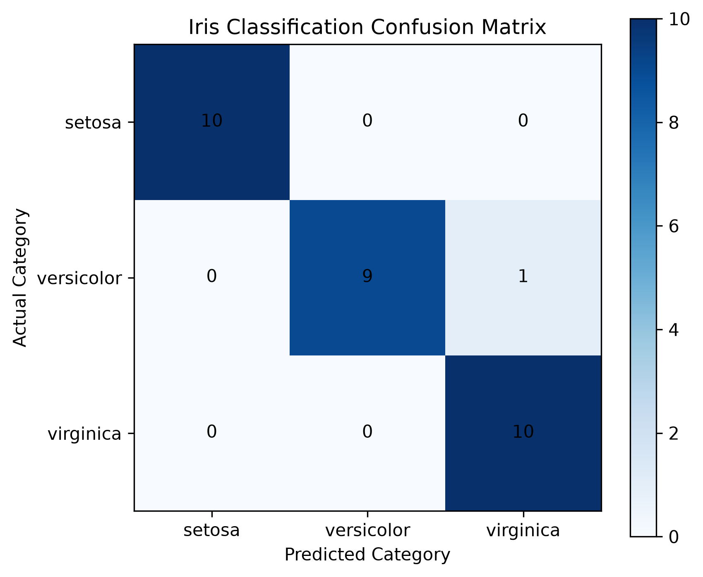

# 🌸 Iris Flower Species Classification Using Machine Learning

**Student:** Philip Antwi  
**Programme:** BSc Information Technology  
**Institution:** Pentecost University, Accra, Ghana  
**Live Application:** [https://iris-classification-project-rk73.vercel.app/](https://iris-classification-project-rk73.vercel.app/)

---

## Project Overview

This project develops and deploys a **machine learning classification system** that predicts the species of an Iris flower based on four physical measurements. The system uses **Logistic Regression** — a supervised machine learning algorithm — to classify flowers into three species:

- 🌱 **Iris Setosa**
- 🌼 **Iris Versicolor**
- 🌺 **Iris Virginica**

The application was initially prototyped in **Streamlit** and subsequently migrated to a production web application built with **HTML, CSS, and JavaScript**, served by a **Python prediction API** deployed on **Vercel**.

---

## Project Objectives

1. Train and evaluate a Logistic Regression model on the Iris dataset.
2. Achieve high classification accuracy on unseen test data.
3. Serialise the trained model for reuse without retraining.
4. Build an interactive web application for real-time predictions.
5. Deploy the application publicly on the Vercel cloud platform.

---

## Dataset

The project uses the **Iris dataset** from Scikit-learn (`sklearn.datasets.load_iris`).

| Property          | Details                            |
|-------------------|------------------------------------|
| Total Samples     | 150 (50 per species)               |
| Features          | 4 numerical measurements (cm)      |
| Target Classes    | 3 (Setosa, Versicolor, Virginica)  |
| Missing Values    | None                               |
| Class Balance     | Perfectly balanced                 |

**Input Features:**
1. Sepal Length (cm)
2. Sepal Width (cm)
3. Petal Length (cm)
4. Petal Width (cm)

---

## Machine Learning Model

| Component         | Details                                              |
|-------------------|------------------------------------------------------|
| Algorithm         | Logistic Regression (`sklearn.linear_model`)         |
| Solver            | L-BFGS (default)                                     |
| Max Iterations    | 200                                                  |
| Train Split       | 80% (120 samples, stratified)                        |
| Test Split        | 20% (30 samples, stratified)                         |
| Random State      | 42 (reproducible)                                    |

---

## Model Performance

| Metric               | Value    |
|----------------------|----------|
| Test Accuracy        | **96.67%** |
| Macro Avg Precision  | 0.97     |
| Macro Avg Recall     | 0.97     |
| Macro Avg F1-Score   | 0.97     |

### Confusion Matrix

```
              Setosa  Versicolor  Virginica
Setosa          10         0          0
Versicolor       0         9          1
Virginica        0         0         10
```

The model perfectly classified Setosa and Virginica. One Versicolor sample was misclassified as Virginica, resulting in a 96.67% overall accuracy.

**Confusion Matrix Image:**



---

## Classification Report

```
                  precision    recall  f1-score   support

      setosa       1.00      1.00      1.00        10
  versicolor       1.00      0.90      0.95        10
   virginica       0.91      1.00      0.95        10

    accuracy                           0.97        30
   macro avg       0.97      0.97      0.97        30
weighted avg       0.97      0.97      0.97        30
```

---

## System Architecture

```
 Browser (User)
      │
      ▼
 index.html   ──── HTML / CSS / JavaScript (Frontend)
      │
      ▼  HTTP POST /api/predict (JSON)
      │
 api/predict.py  ──── Python Serverless Function (Vercel)
      │
      ▼
 iris_model.pkl  ──── Trained Logistic Regression Model
```

---

## Project Files

| File                       | Description                                              |
|----------------------------|----------------------------------------------------------|
| `iris_classification.py`   | Model training, evaluation, and confusion matrix script  |
| `iris_model.pkl`           | Serialised trained model (Joblib)                        |
| `app.py`                   | Streamlit prototype application                          |
| `index.html`               | Production web application (HTML/CSS/JavaScript)         |
| `api/predict.py`           | Python prediction API (Vercel serverless handler)        |
| `api/requirements.txt`     | Python dependencies for the serverless environment       |
| `vercel.json`              | Vercel deployment configuration                          |
| `confusion_matrix.png`     | Confusion matrix visualisation (300 DPI)                 |
| `requirements.txt`         | Python dependencies for local development                |

---

## Technologies Used

| Technology     | Purpose                                      |
|----------------|----------------------------------------------|
| Python 3.10+   | Core programming language                    |
| Scikit-learn   | Dataset, model training, and evaluation      |
| NumPy          | Numerical array operations                   |
| Pandas         | Data manipulation (Streamlit prototype)      |
| Matplotlib     | Confusion matrix visualisation               |
| Joblib         | Model serialisation and deserialisation      |
| Streamlit      | Interactive prototype application            |
| HTML/CSS/JS    | Production web frontend                      |
| Vercel         | Cloud deployment (serverless functions)      |
| GitHub         | Version control and source code hosting      |

---

## How to Run Locally

### Step 1 — Clone the repository

```bash
git clone https://github.com/Philipntwi-bot/Iris_Classification_Project.git
cd Iris_Classification_Project
```

### Step 2 — Install dependencies

```bash
pip install -r requirements.txt
```

### Step 3 — Train the model (optional — model is pre-trained)

```bash
python iris_classification.py
```

### Step 4 — Run the Streamlit application

```bash
python -m streamlit run app.py
```

The application will open at `http://localhost:8501`.

---

## Live Deployment

The production application is deployed on Vercel and publicly accessible at:

👉 **[https://iris-classification-project-rk73.vercel.app/](https://iris-classification-project-rk73.vercel.app/)**

The Vercel deployment uses:
- `index.html` as the static frontend entry point
- `api/predict.py` as the Python serverless prediction function
- `iris_model.pkl` loaded at runtime by the API
- `vercel.json` with `"framework": null` for plain static + serverless configuration

---

## API Endpoint

**POST** `/api/predict`

**Request Body (JSON):**
```json
{
  "sepal_length": 5.1,
  "sepal_width": 3.5,
  "petal_length": 1.4,
  "petal_width": 0.2
}
```

**Response (JSON):**
```json
{
  "predicted_species": "setosa",
  "confidence": 99.75,
  "probabilities": {
    "setosa": 99.75,
    "versicolor": 0.24,
    "virginica": 0.01
  }
}
```

---

## Conclusion

This project demonstrates the complete machine learning application lifecycle — from data loading and model training through serialisation, API development, frontend design, and cloud deployment. Logistic Regression achieves 96.67% accuracy on the Iris test set, confirming its effectiveness for this multi-class classification task. The deployed web application makes the model accessible to end-users without any technical knowledge.

---

## Academic Report

A full academic report documenting this project is included in the repository:

- 📄 `Iris_Flower_Classification_Report.docx` — Microsoft Word document
- 📄 `Iris_Flower_Classification_Report.pdf` — PDF document

The report covers dataset description, algorithm explanation, model evaluation, system design, deployment, and IEEE-formatted references.

---

*Iris Flower Classification Project | BSc Information Technology | Pentecost University*
